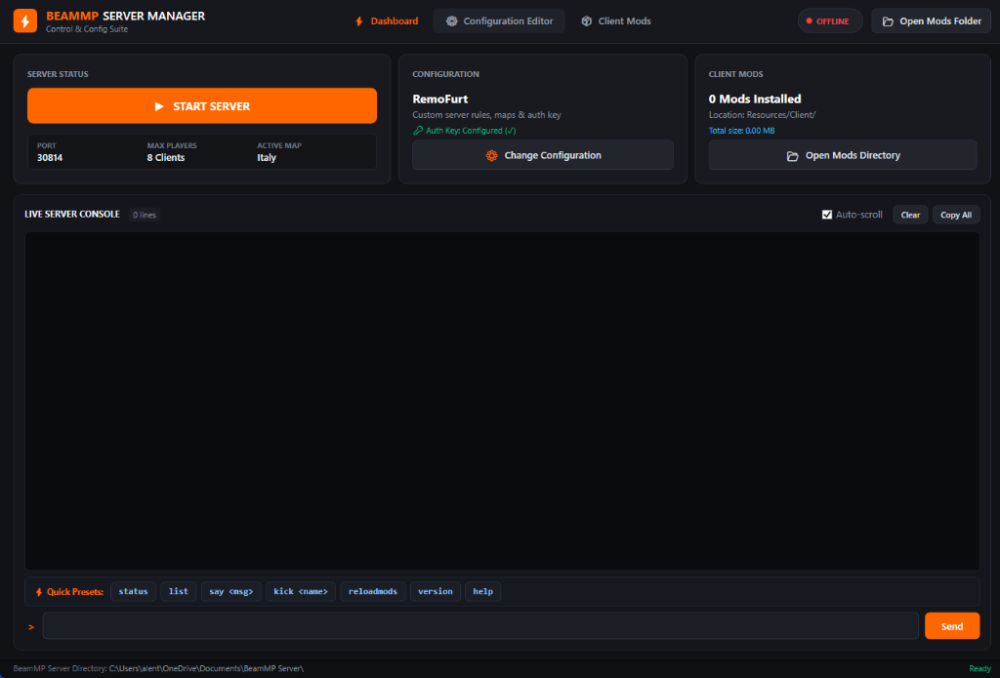
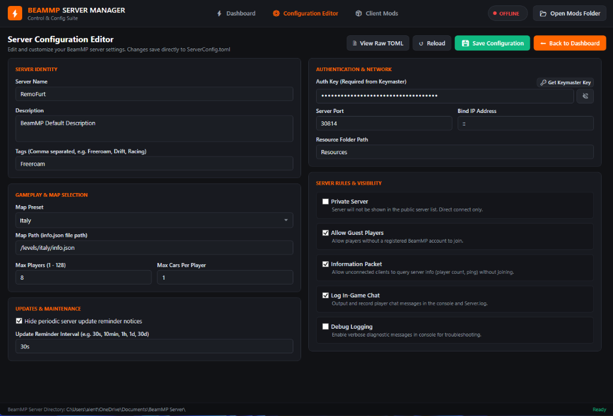
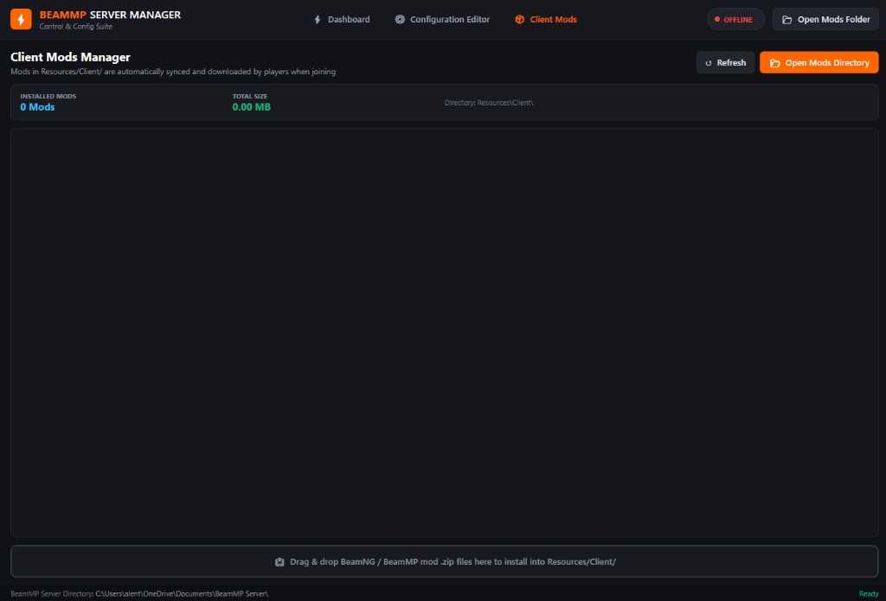

# BeamMP-GUI

A lightweight, native Windows desktop manager and configuration GUI for [BeamMP Server](https://beammp.com).

---

## Screenshots

### Dashboard & Live Console


### Dedicated Configuration Editor


### Client Mods Manager


---

## Setup Instructions

### Option 1: Installer (Recommended)
1. Download **`BeamMP-GUI-Installer.exe`** from [Releases](https://github.com/alentrost/BeamMP-GUI/releases/latest).
2. Run the installer and select your BeamMP server folder (where `BeamMP-Server.exe` is located).
3. Select your preferred shortcut options (**Desktop** and/or **Start Menu**).
4. Click **Install**.

### Option 2: Portable / Standalone
1. Download **`BeamMP-GUI.exe`** from [Releases](https://github.com/alentrost/BeamMP-GUI/releases/latest).
2. Drop `BeamMP-GUI.exe` directly into your BeamMP server folder (where `BeamMP-Server.exe` and `ServerConfig.toml` are located).
3. Run `BeamMP-GUI.exe`.

> **Note:** Requires Windows 10 or 11 (.NET Framework 4.8 is built-in). No external runtimes (Python, Node, etc.) required.

---

## Features

- **Standard Windows Installer:** Verifies your server directory and sets up Desktop and Start Menu shortcuts.
- **One-Click Server Control:** Start, stop, and restart `BeamMP-Server.exe` with real-time process ID, port, and uptime tracking.
- **Live Interactive Console:** Standard output and error streaming with auto-scroll, copy, clear, and interactive command sending.
- **Console Command Presets:** Quick one-click execution for `status`, `list`, `say`, `kick`, `reloadmods`, `version`, and `help`.
- **Dedicated Configuration Editor:** Visual form editor for `ServerConfig.toml`:
  - Official BeamNG map presets (*Italy, West Coast USA, East Coast USA, Gridmap v2, Utah, Jungle Rock Island, etc.*) + custom map paths.
  - Max player and car limits.
  - AuthKey field with show/hide toggle and Keymaster shortcut.
  - Server privacy, guest players, information packets, and chat logging toggles.
- **Raw TOML Editor:** Instant toggle between visual form and raw `ServerConfig.toml` text editing with comment preservation.
- **Client Mods Integration:** View installed `.zip` mods and disk usage, open `Resources/Client/` in Explorer, and drag-and-drop `.zip` files to install.
- **Safe Process Shutdown:** Gracefully sends `exit` command on stop to prevent locked networking ports.

---

## Building from Source

To build `BeamMP-GUI.exe` and `BeamMP-GUI-Installer.exe` yourself:

1. Clone the repository:
   ```cmd
   git clone https://github.com/alentrost/BeamMP-GUI.git
   cd BeamMP-GUI
   ```
2. Run `build.bat` or build using MSBuild:
   ```cmd
   build.bat
   ```
